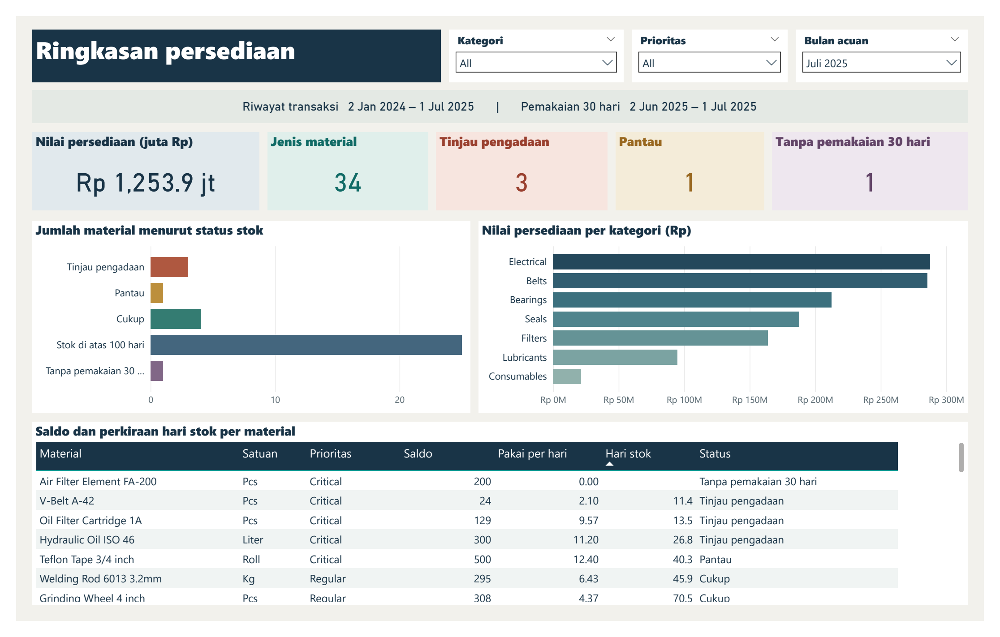

# Analisis persediaan MRO dengan Power BI

**Fahmi Akbari** · Studi kasus operasional gudang dengan data simulasi

Pada 1 Juli 2025, gudang masih menyimpan 24 buah V-Belt A-42. Dalam 30 hari terakhir, 63 buah sudah keluar. Dengan laju itu, persediaannya cukup untuk sekitar **11 hari**. Material ini menjadi prioritas pertama untuk mengecek kapan pesanan berikutnya tiba.

Saya menggunakan kartu stok Excel untuk menjawab dua pertanyaan gudang. Material mana yang paling dekat kehabisan stok, dan di mana nilai persediaan paling banyak tersimpan? Data mencakup **2.545 transaksi, 34 material, dan 7 kategori** untuk kebutuhan *maintenance, repair, and operations* (MRO).

[Baca studi kasus (PDF)](docs/studi-kasus.pdf) · [Lihat ketiga halaman dashboard (PDF)](docs/dashboard.pdf) · [Unduh laporan Power BI](dashboard/Fahmi_Akbari_MRO_Bulanan.pbix)



## Material yang perlu ditinjau

Per **1 Juli 2025**, tiga dari delapan material berprioritas *Critical* masuk daftar **Tinjau pengadaan**. Walaupun jumlah filter oli di rak lebih dari lima kali jumlah V-belt, stok keduanya diperkirakan habis dalam rentang yang berdekatan.

| Material | Saldo terakhir | Keluar dalam 30 hari | Perkiraan hari stok |
| --- | ---: | ---: | ---: |
| V-Belt A-42 | 24 buah | 63 buah | 11,4 hari |
| Oil Filter Cartridge 1A | 129 buah | 287 buah | 13,5 hari |
| Hydraulic Oil ISO 46 | 300 liter | 336 liter | 26,8 hari |

Estimasi nilai seluruh persediaan mencapai **Rp1.253.895.500**. Conveyor Belt EP200, Mechanical Seal 28mm, dan Roller Bearing 22210 menyumbang Rp432.895.000 atau sekitar **34,5%** dari nilai itu. Ketiganya menjadi titik awal untuk memeriksa stok fisik dan kebutuhan suku cadang. [Lihat hasil untuk 34 material (CSV)](data/saldo-2025-07-01.csv)

## Menjelajahi dashboard

| Halaman | Yang bisa diperiksa |
| --- | --- |
| Ringkasan persediaan | Nilai stok per kategori, jumlah material per status, dan saldo per material. |
| Prioritas pengadaan | Saldo, pemakaian 30 hari, dan perkiraan hari stok dalam satu tabel. [Lihat halaman](images/prioritas-pengadaan.png) |
| Mutasi material | Riwayat penerimaan dan pengeluaran, nilai pengeluaran per bulan, serta material dengan pemakaian terendah pada periode terpilih. [Lihat halaman](images/mutasi-material.png) |

**Bulan acuan** di kanan atas berlaku untuk ketiga halaman. Ada 19 pilihan dari Januari 2024 sampai Juli 2025. Pilih **Juni 2025** untuk melihat stok per 30 Juni dan pemakaian 1–30 Juni. Jika memilih **Juli 2025**, tanggal acuannya 1 Juli karena data berakhir pada tanggal tersebut. Periode pemakaian bergeser menjadi 2 Juni–1 Juli. Grafik mutasi bulanan tetap menampilkan seluruh riwayat sejak 2 Januari 2024.

## Dari kartu stok ke angka dashboard

1. **Merapikan transaksi.** Pada kartu stok, identitas material tertulis di awal setiap blok. Power Query meneruskan identitas tersebut ke baris transaksi dan menggunakan `DATE` serta `INDEX` numerik untuk membedakan urutan mutasi pada hari yang sama.
2. **Menentukan saldo.** Untuk tiap material, model mengambil `REMAINING` dari transaksi terakhir sampai tanggal acuan. Nilai persediaan dihitung dengan mengalikan saldo itu dengan harga satuan pada transaksi yang sama. Nilai rupiah bisa dijumlahkan lintas material, sedangkan jumlah fisik dibaca menurut satuannya.
3. **Menghitung hari stok.** Pemakaian harian rata-rata adalah total `ISSUED` dalam 30 hari kalender dibagi 30. Saldo terakhir dibagi rata-rata tersebut untuk memperoleh perkiraan hari stok. Jika riwayat material belum cukup atau tidak ada pemakaian, perkiraan hari stok dikosongkan.
4. **Menandai prioritas.** Dalam studi kasus ini, status *Tinjau pengadaan* muncul saat stok diperkirakan cukup untuk kurang dari 35 hari bagi material *Critical* atau 25 hari bagi *Regular*. Untuk menentukan jumlah pembelian, tim masih membutuhkan waktu kirim pemasok, alokasi stok, dan PO yang sedang berjalan.

[Lihat query Power Query untuk transaksi](model/transactions.pq) · [Lihat rumus DAX yang dipakai laporan](model/measures.dax)

### Bagaimana pengeluaran tanpa nomor WO ditangani?

Ada **305 penerimaan** dengan referensi PO dan **2.240 pengeluaran**. Nomor WO sudah tercatat pada 2.075 pengeluaran. Untuk 165 sisanya, salinan Excel memakai referensi pengganti unik berawalan `WO-SIM-`. Tahun dan nomor baris pada kode itu memudahkan penelusuran ke kartu stok. Nomor WO asli dan alasan kolom kosong belum diketahui. Karena jumlah barang keluar tercatat di `ISSUED`, seluruh 165 baris tetap masuk perhitungan pemakaian.

## Membuka laporan di komputer sendiri

1. Unduh repositori melalui **Code → Download ZIP**, lalu ekstrak isinya.
2. Buka `dashboard/Fahmi_Akbari_MRO_Bulanan.pbix` di **Power BI Desktop**. Data sudah tersimpan di dalam laporan. Untuk membaca hasilnya tanpa Power BI, buka [PDF dashboard](docs/dashboard.pdf).
3. Untuk memuat ulang sumber, pilih **Home → Transform data → Edit parameters**. Ubah `SourceWorkbook` ke lokasi lengkap [MRO_DATA_INVENTORY.xlsx](data/MRO_DATA_INVENTORY.xlsx) di komputer sendiri, terapkan perubahan, lalu pilih **Refresh**.

## Memeriksa hasil

Folder `validasi/` berisi kueri DAX beserta hasilnya. Untuk mengulang pengujian, buka PBIX, tempel isi salah satu file `.dax` ke **DAX Query View**, lalu jalankan. Angka per material juga dapat dibandingkan dengan [rekap CSV](data/saldo-2025-07-01.csv).

| Pemeriksaan | Kueri | Hasil tersimpan |
| --- | --- | --- |
| Saldo, pemakaian, hari stok, status, dan nilai untuk 34 material | [Uji per material](validasi/Uji_item.dax) | [Hasil per material](validasi/Hasil_item.json) |
| Total gudang dan hasil filter kategori, prioritas, material, serta tanggal | [Uji filter](validasi/Uji_filter.dax) | [Hasil filter](validasi/Hasil_filter.json) |
| Kelengkapan referensi dan keunikan 165 nomor WO simulasi | [Uji referensi](validasi/Uji_referensi.dax) | [Hasil referensi](validasi/Hasil_referensi.json) |
| Tanggal acuan dan periode pemakaian untuk 19 bulan | [Uji periode](validasi/Periode.dax) | [Hasil periode](validasi/Periode.json) |

Pemeriksaan referensi menghasilkan 2.545 transaksi dengan referensi terisi, termasuk 165 kode WO-SIM yang unik. Rekonsiliasi 34 material mencakup saldo, pemakaian, hari stok, status, dan nilai. Untuk contoh filter, kategori Belts menghasilkan lima material senilai Rp285.588.000, sedangkan V-Belt A-42 menghasilkan saldo 24 buah senilai Rp1.152.000.

## Susunan file

```text
README.md
dashboard/
  Fahmi_Akbari_MRO_Bulanan.pbix
data/
  MRO_DATA_INVENTORY.xlsx
  saldo-2025-07-01.csv
docs/
  studi-kasus.pdf
  dashboard.pdf
images/
  ringkasan-persediaan.png
  prioritas-pengadaan.png
  mutasi-material.png
model/
  measures.dax
  transactions.pq
validasi/
  Uji_item.dax
  Hasil_item.json
  Uji_filter.dax
  Hasil_filter.json
  Uji_referensi.dax
  Hasil_referensi.json
  Periode.dax
  Periode.json
```

## Cakupan studi kasus

Data yang digunakan adalah kartu stok simulasi. Perkiraan hari stok mengikuti laju pemakaian 30 hari terakhir. Model memakai ambang peninjauan awal yang perlu disesuaikan dengan waktu pengadaan dan kebutuhan pemeliharaan pada penerapan operasional. Juli 2025 baru mencakup satu hari, sehingga nilai pengeluaran bulannya perlu dibaca dengan cakupan tersebut.

Data pesanan terbuka, reservasi material, dan jadwal pemeliharaan dapat melengkapi analisis ini. Dengan informasi itu, daftar tinjauan bisa dilanjutkan ke perencanaan tanggal dan jumlah pembelian.

## Tentang pengerjaan

Fahmi Akbari menyediakan workbook dan proyek Power BI awal serta meninjau interpretasi data dan kebutuhan dashboard. Pengembangan lanjutan memakai bantuan AI untuk pengolahan referensi simulasi, penyempurnaan model dan tampilan, pemeriksaan hasil, serta dokumentasi.
